<div align="center">

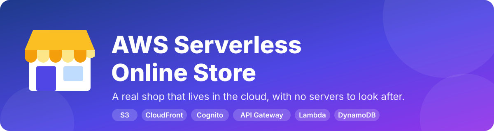

<br>

[](https://github.com/IndushreeDN/aws-online-store/actions/workflows/ci.yml)


[](LICENSE)

**A complete online shop that runs on AWS with no servers to look after.**<br>
Products · sign-up & login · cart · checkout (pretend payment) · order history · admin page

[ Explain it simply](#-explain-it-like-im-6) · [ Screenshots](#-what-it-looks-like) · [ Setup guide](#-step-by-step-setup-guide) · [ Try it](#-things-to-try-good-and-bad-cases) · [ Help](#-troubleshooting)

</div>

---

##  Contents

1. [What is this?](#-what-is-this)
2. [Explain it like I'm 6](#-explain-it-like-im-6)
3. [What it looks like](#-what-it-looks-like)
4. [How it works (for developers)](#-how-it-works-for-developers)
5. [Step-by-step setup guide](#-step-by-step-setup-guide) — Steps 1 to 10
6. [Things to try: good and bad cases](#-things-to-try-good-and-bad-cases)
7. [Automatic tests](#-automatic-tests)
8. [Project map](#-project-map) · [API](#-api) · [Design decisions](#-design-decisions-worth-knowing)
9. [Cost and safety](#-cost-and-safety)
10. [Troubleshooting](#-troubleshooting)
11. [Ideas for next steps](#-ideas-for-next-steps) · [License](#-license)

---

## 🛒 What is this?

This is a **working online shop**. People can browse products, create an account, fill a cart, "pay" with a *pretend* payment, and see their orders. The shop owner gets an **Admin page** to change prices and stock and to add new products.

The special part is **how it is hosted**. There is no computer that we rent, install and keep switched on. Instead the shop is built from small AWS services that wake up only when somebody uses them. That style is called **serverless**.

|  You get |  You do *not* need |
| --- | --- |
| A real shop on a real web address (HTTPS) | To buy, install or patch a server |
| Safe sign-up and login | To store passwords yourself |
| A database that grows by itself | To manage database software |
| One file that builds *everything* (`template.yaml`) | To click through the AWS console for hours |
| 92 automatic tests (good **and** bad cases) | An AWS account just to run the tests |

> [!NOTE]
> **Learning project.** Payments are simulated and no card details are ever collected. Do not use it to take real money without adding a real payment provider first.

---

##  Explain it like I'm 6

*(This section is written so you can read it out loud to a Class 1 child, a friend who has never coded, or a teacher.)*

### The story: **Indu's Toy Shop** 

Imagine a toy shop. A shop needs a few things to work:

|  In the toy shop |  The real AWS name |  Say it like this |
| --- | --- | --- |
| **The shop window and shelves**, with a copy of the window in every town so you can see it fast | S3 + CloudFront | "A picture-book of our shop. Anyone, anywhere, can open it quickly." |
| **The door-keeper** who checks your school ID card | Cognito | "Only people with their own ID card can buy. Nobody can pretend to be you." |
| **The helper at the counter** who listens to you | API Gateway | "You say what you want. The helper passes your note to the right worker." |
| **Tiny workers who nap** until someone calls them. Each one knows **one** job | Lambda | "One worker shows toys. Another takes orders. When nobody is shopping they sleep, so nothing is wasted." |
| **The big notebook** where the shop writes every toy and every order | DynamoDB | "Our shop's memory. It remembers what we have and who bought what." |
| **The postman** who delivers the "thank you" letter *(optional)* | SES | "He sends a message to say your order is on its way." |
| **A LEGO instruction sheet** for building the whole shop | CloudFormation / SAM (`template.yaml`) | "One paper that tells the computer how to build the entire shop, so we can build it again any time." |

###  What happens when you buy a toy?

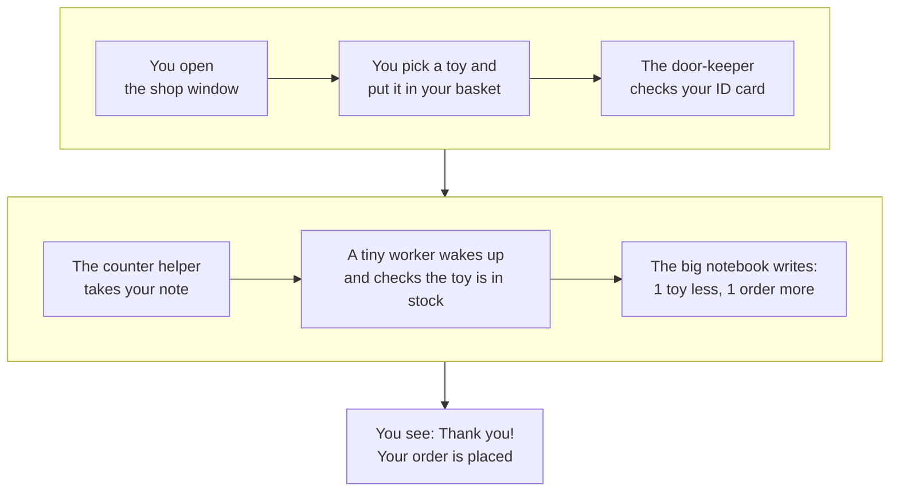

1. **You open the shop window.** (The website loads.)
2. **You choose a toy.** (You add it to your cart. The basket stays in *your* browser.)
3. **You show your ID card.** (You sign in.)
4. **The counter helper takes your note.** (Your browser sends the order.)
5. **A tiny worker wakes up.** It looks in the notebook: *is the toy really here? what is the real price?*
6. **The notebook is updated** – one toy fewer, one new order. This happens **all together or not at all**, like putting a toy in the bag *and* taking the money in one go.
7. **You get a "Thank you!"** and the tiny worker goes back to sleep. 

###  Three rules the shop never breaks

| Rule | Child-friendly version | Why it matters |
| --- | --- | --- |
| **Prices come from the shop, not from you** | "You can't change the price tag yourself." | Nobody can pay ₹1 for a ₹1,499 toy. |
| **Never sell a toy we don't have** | "If the last toy is gone, it's gone." | Two people can't both buy the last one. |
| **Only pretend money** | "We play shop – nobody pays real money." | Safe for learning. No card numbers are ever asked. |

###  The 30-second version (for a presentation)

> "We built an online shop with **no servers of our own**. The website sits in **S3 and CloudFront**. **Cognito** handles login. **API Gateway** receives requests and passes them to small **Lambda** functions. They read and write **DynamoDB**. One **template file** builds everything, and **92 automatic tests** check both good and bad cases."

###  "Serverless" – does it mean there are *no* computers?

No. There are computers, but **Amazon looks after them**, not us. It is like a school with a caretaker: the teachers teach and don't have to mop the floor. We only write the shop's *rules*; AWS keeps the machines running.

---

##  What it looks like

<div align="center">

**The shop** &nbsp;·&nbsp; 12 sample products, search and category buttons

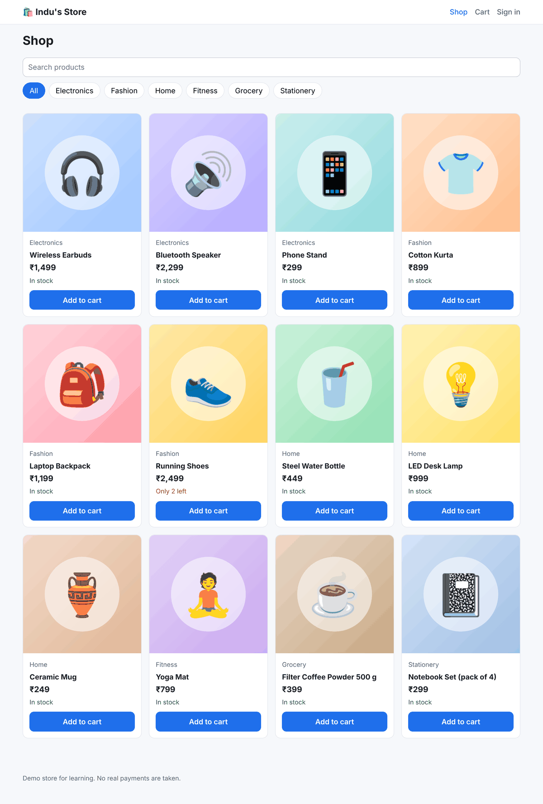

</div>

<table>
<tr>
<td width="50%" valign="top">

**Product page** – shows how many are left

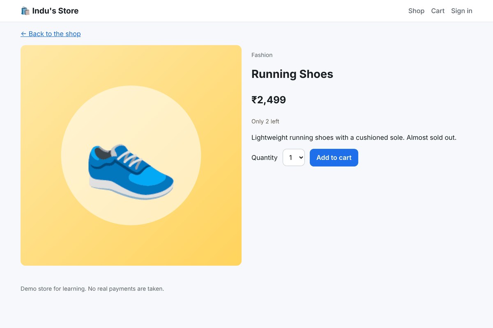

</td>
<td width="50%" valign="top">

**Cart** – change quantity, remove items, see delivery

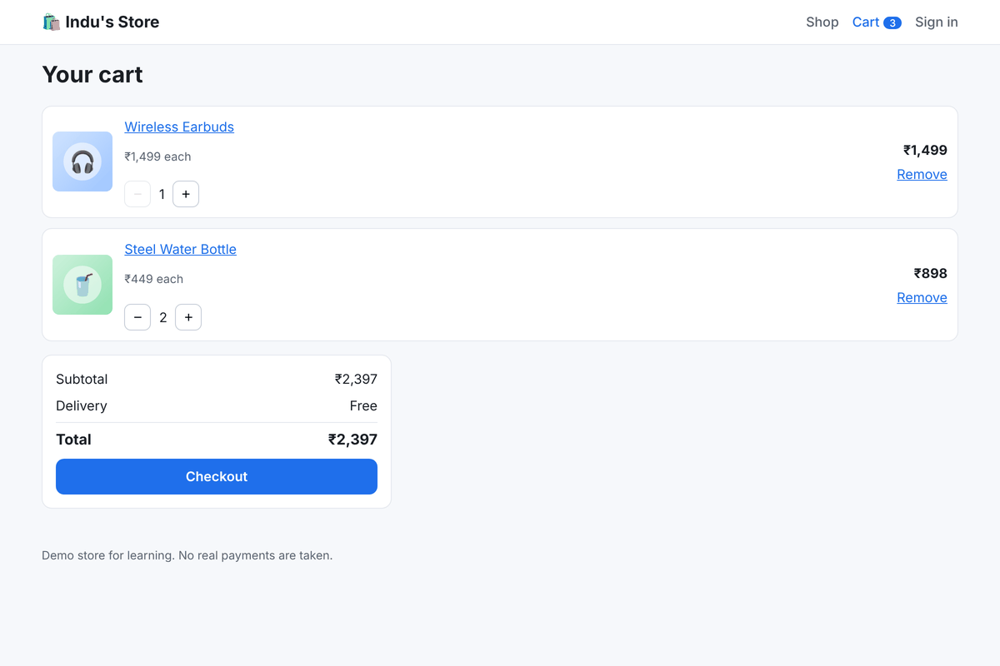

</td>
</tr>
<tr>
<td valign="top">

**Sign in** – accounts are handled by Amazon Cognito

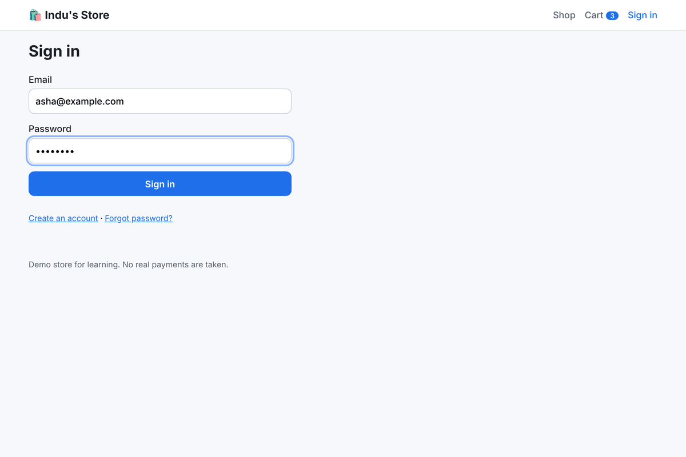

</td>
<td valign="top">

**Checkout** – safe, pretend payment options

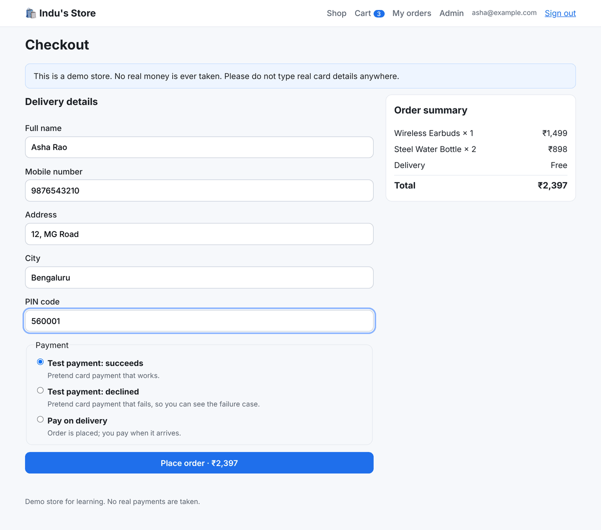

</td>
</tr>
<tr>
<td valign="top">

**When something goes wrong** – a declined test payment changes nothing

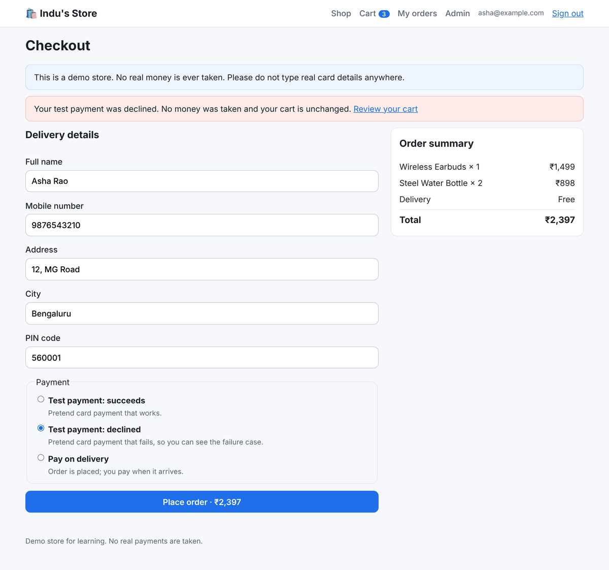

</td>
<td valign="top">

**When it goes right** – the order appears in *My orders*

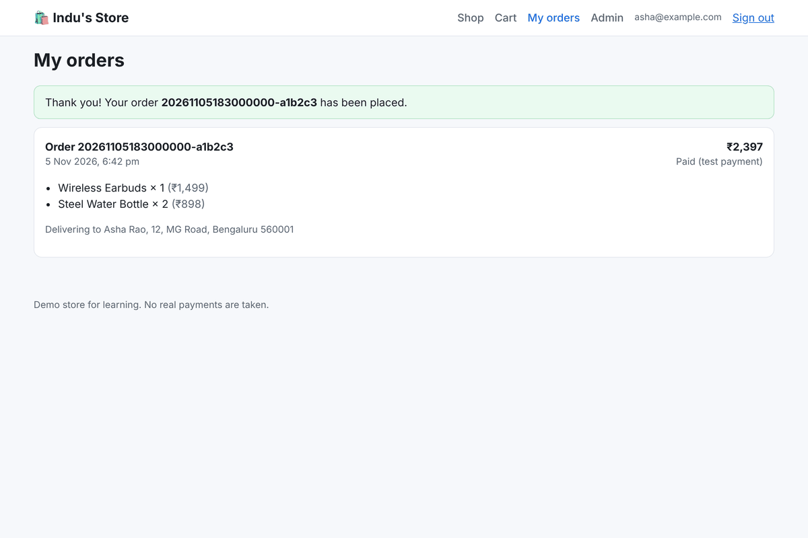

</td>
</tr>
</table>

<div align="center">

**Admin page** (only for admins) – change price, stock and visibility, or add a product

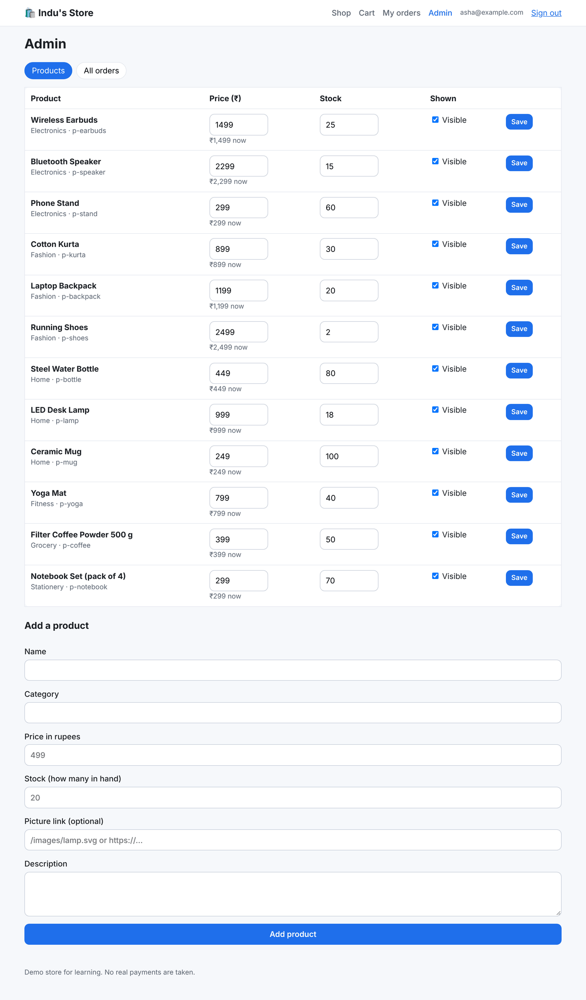

**Works on phones too**

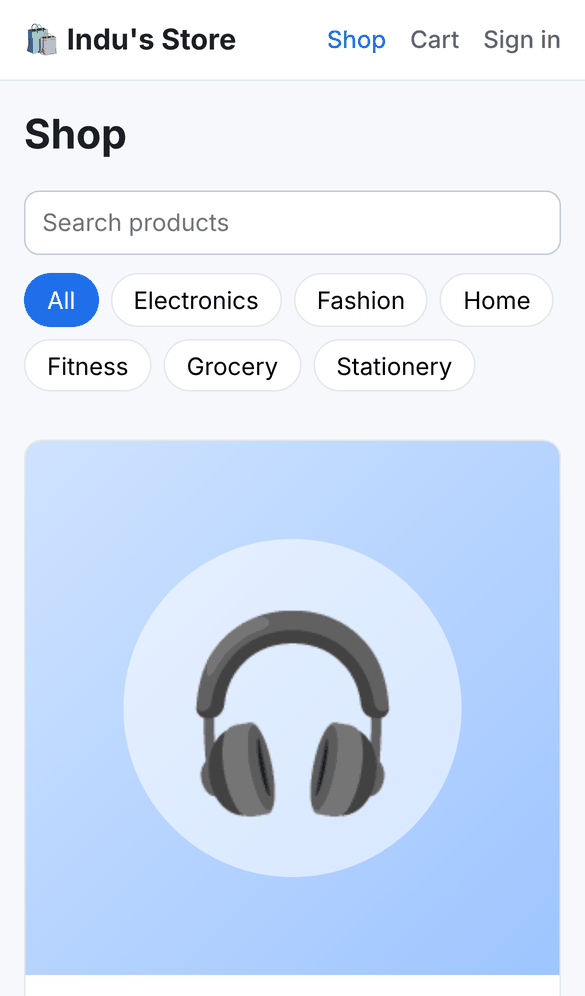

</div>

> The screenshots were taken from the real website running on a computer, with sample data.

---

## 🧩 How it works (for developers)

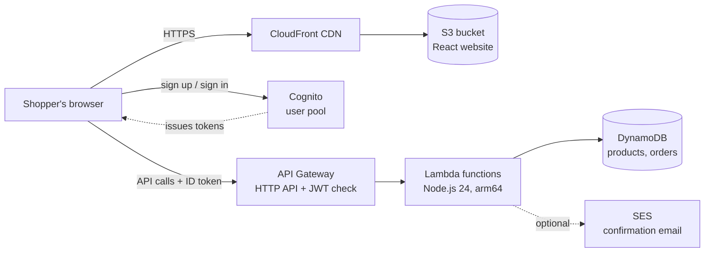

| Piece | AWS service | Job |
| --- | --- | --- |
| Website | S3 + CloudFront | Serves the React app over HTTPS, worldwide. The bucket is private; only CloudFront may read it. |
| Login | Cognito | Accounts, passwords, email confirmation codes, and an `admins` group |
| Front door | API Gateway (HTTP API) | Checks the login token, throttles traffic, calls the right function |
| Logic | Lambda (8 functions) | Products, orders, admin actions |
| Data | DynamoDB (2 tables, pay-per-request) | `eshop-products`, `eshop-orders` |
| Email *(optional)* | SES | Order confirmation |
| Setup | CloudFormation via SAM | `template.yaml` creates everything above |

<details>
<summary><b>🔍 What happens inside one order (sequence diagram)</b></summary>

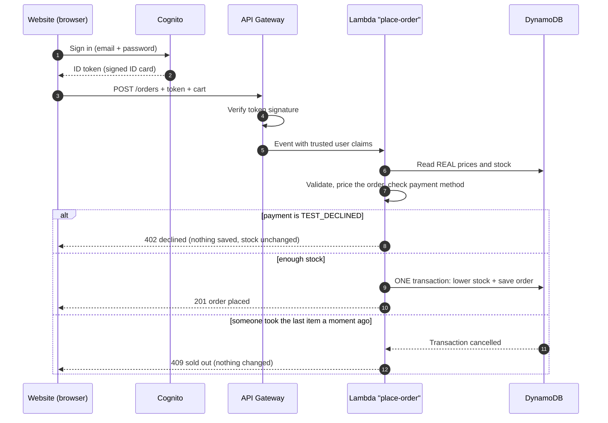

</details>

**Tech stack:** React 19 + Vite 8 + React Router 7 (website) · Node.js 24 ES modules on Lambda (arm64) · DynamoDB · Cognito · API Gateway HTTP API · CloudFront + S3 · AWS SAM · `node:test` and Vitest for tests · GitHub Actions for CI.

---

##  Step-by-step setup guide

> [!TIP]
> **Already know AWS?** Skip to the short version: have an AWS account, Node.js 24, AWS CLI v2 and SAM CLI, run `aws configure`, then
>
> ```bash
> git clone https://github.com/IndushreeDN/aws-online-store.git && cd aws-online-store
> npm run setup && npm test
> npm run deploy:backend && npm run seed
> npm run deploy:site        # prints your live address
> ```
>
> Everyone else: follow the 10 steps below. Each one says **what you do**, **what you should see**, and **what to do if it fails**.

⏱️ **Time needed:** about 45–60 minutes the first time (most of it is waiting for AWS and installing tools).

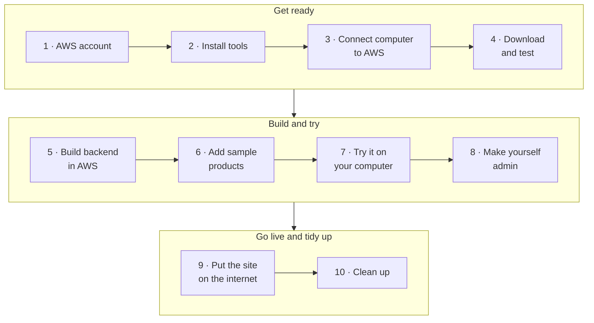

> **How to read the boxes below:**  *In plain words* explains the step simply. 🔧 *Technical detail* is for developers.
> **Where do I type commands?** In a *terminal*: **Windows** → open **Windows Terminal** or **PowerShell** from the Start menu. **Mac** → open **Terminal**. Type (or paste) each command and press **Enter**. Lines starting with `#` are notes, not commands.

---

### Step 1 · Get an AWS account and a safe "user" 

 *In plain words:* AWS is like a giant rented workshop. You need your own key to get in, and we make a **second, everyday key** so the master key stays locked in a drawer.

1. Go to **<https://aws.amazon.com/>** and choose **Create an AWS account**. You will need an email address, a phone number and a card for identity checks.
2. Sign in to the **AWS Management Console**. This first login is the **root user** (the master key). **Do not use it for daily work.**
3. In the console search bar type **IAM** and open it → **Users** → **Create user**.
4. User name: `eshop-admin` (any name works). Choose **Attach policies directly** and tick **AdministratorAccess**. Finish with **Create user**.
5. Open the new user → **Security credentials** → **Create access key** → choose **Command Line Interface (CLI)** → create it. You will see an **Access key ID** and a **Secret access key**. **Copy both somewhere private now** — AWS shows the secret only once.
6. **Strongly recommended – set a spending alarm:** console → **Billing and Cost Management → Budgets → Create budget**, choose a small monthly amount, and add your email for alerts.

 **You should have:** an Access key ID (starts with `AKIA…`) and a Secret access key saved privately.

> [!WARNING]
> **Never paste your secret key into GitHub, a chat, a screenshot or any file in this project.** Anyone who has it can use (and bill) your AWS account. If you ever leak it: IAM → your user → **Security credentials** → **Deactivate / delete** the key and make a new one.

🔧 *Technical detail:* `AdministratorAccess` is the simplest choice for learning. In a real company use a narrower policy or IAM Identity Center (SSO). The deploy creates IAM roles, so the deploying identity needs IAM permissions (SAM is called with `CAPABILITY_IAM`).

---

### Step 2 · Install the four tools 

 *In plain words:* We need four helpers on your computer: one to run our code, one to download the project, one to talk to AWS, and one to build the shop from the instruction sheet.

| Tool | What it is for | Download | Check it worked |
| --- | --- | --- | --- |
| **Node.js 24** (LTS) | Runs the code and the tests | <https://nodejs.org> | `node --version` → `v24.x.x` |
| **Git** | Downloads the project | <https://git-scm.com/downloads> | `git --version` |
| **AWS CLI v2** | Lets your computer talk to AWS | [Install guide](https://docs.aws.amazon.com/cli/latest/userguide/getting-started-install.html) | `aws --version` → `aws-cli/2.x` |
| **AWS SAM CLI** | Builds & deploys `template.yaml` | [Install guide](https://docs.aws.amazon.com/serverless-application-model/latest/developerguide/install-sam-cli.html) | `sam --version` |

 **After installing, close the terminal and open a NEW one**, otherwise the new commands will not be found.

 **You should see** a version number for each of the four check commands.

🔧 *Technical detail:* `package.json` allows Node `>=22.12`; `.node-version` and CI use 24, and the Lambda runtime is `nodejs24.x`. Docker is **not** required (no native dependencies; the AWS SDK v3 is provided by the Lambda runtime).

<details>
<summary><b> If a command says "not found" / "not recognized"</b></summary>

You most likely need to **close and reopen the terminal** (or restart the computer once on Windows). If it still fails, run the installer again and make sure the option to *add to PATH* is ticked.

**Windows + PowerShell error "running scripts is disabled on this system"** when you run `npm`: run this once, then retry:

```powershell
Set-ExecutionPolicy -Scope CurrentUser -ExecutionPolicy RemoteSigned
```

</details>

---

### Step 3 · Connect your computer to AWS 

 *In plain words:* We give your computer the everyday key from Step 1 so it is allowed to build things in your AWS workshop.

```bash
aws configure
```

It asks four questions. Type the answers and press **Enter** after each:

| It asks | You type |
| --- | --- |
| `AWS Access Key ID` | the Access key ID from Step 1 |
| `AWS Secret Access Key` | the Secret access key from Step 1 |
| `Default region name` | `ap-south-1` (Mumbai) – or the region closest to you, e.g. `us-east-1`, `eu-west-1` |
| `Default output format` | `json` |

Now check that it works:

```bash
aws sts get-caller-identity
```

 **You should see** a small block of text containing your `Account` number and a `Arn` ending in `user/eshop-admin`.

 **If you see** `Unable to locate credentials` → run `aws configure` again. **If you see** `InvalidClientTokenId` → the keys were typed wrongly; run `aws configure` again.

🔧 *Technical detail:* `samconfig.toml` has no region, so SAM and every script use the region from your AWS CLI profile. Keep the **same region** for all later steps. Stack name defaults to `eshop` (override with the `STACK_NAME` environment variable).

---

### Step 4 · Download the project and check it works on your computer 

 *In plain words:* We copy the shop's plans to your computer, then run the shop's built-in "quiz" (the tests) to make sure everything is healthy before we build anything in the cloud.

```bash
git clone https://github.com/IndushreeDN/aws-online-store.git
cd aws-online-store
npm run setup
npm test
```

* `npm run setup` installs the helper libraries for the backend **and** the website (about a minute).
* `npm test` runs the 51 backend tests. They use a pretend database, so **no AWS and no internet are needed**.

 **You should see** at the end of the test output:

```
# tests 51
# pass 51
# fail 0
```

Optionally also run the website tests (41 tests):

```bash
cd frontend
npm test
cd ..
```

 **You should see:** `Tests 41 passed (41)`.

 **If tests fail**, check `node --version` (needs 22.12 or newer; 24 recommended) and run `npm run setup` again.

---

### Step 5 · Build the shop's backend in AWS 

 *In plain words:* Now the computer reads the LEGO instruction sheet (`template.yaml`) and builds the shop's door-keeper, helpers, workers and notebook inside AWS. This is the slow step – time for a snack. 

```bash
npm run deploy:backend
```

This runs `sam build` and then `sam deploy`. It takes **about 5–10 minutes** (CloudFront is the slow part).

 **You should see**, near the end:

```
Successfully created/updated stack - eshop in ap-south-1
```

followed by a table of **Outputs** (`ApiUrl`, `UserPoolId`, `UserPoolClientId`, `SiteUrl`, …). You do not need to copy them – later steps read them for you.

 **If it fails:** open the AWS console → **CloudFormation** → stack `eshop` → **Events** tab. The newest red line says why. Fix it, then run the command again (it is safe to repeat).

🔧 *Technical detail:* Creates 2 DynamoDB tables, a Cognito user pool + client + `admins` group, an HTTP API with a JWT authorizer, 8 Lambda functions (least-privilege policies per function), a private S3 bucket, a CloudFront distribution with Origin Access Control, and a bucket policy. SAM stores the packaged code in a managed bucket (`resolve_s3 = true`).

---

### Step 6 · Put the sample products on the shelves 

 *In plain words:* The shop is built but the shelves are empty. This puts 12 sample toys on them.

```bash
npm run seed
```

 **You should see:** `✔ Added 12 sample products to eshop-products`

 Running it again will **refuse** if products already exist ("so your changes are never overwritten"). To reset to the starting stock on purpose: `npm run seed -- --force`.

---

### Step 7 · Try the shop on your own computer 

 *In plain words:* We tell the website where the door-keeper and counter helper live, then open the shop in your browser.

```bash
npm run configure
npm run dev
```

* `npm run configure` writes the file `frontend/.env` with your shop's addresses ( `✔ Wrote …/frontend/.env`). It is safe to run any number of times. To name your shop: `npm run configure -- --name "My Shop"`.
* `npm run dev` starts the website. Open **<http://localhost:5173>** in your browser.

 **You should see** the shop with 12 products.

**Create your shopper account:** click **Sign in → Create an account**, enter **an email you can open** and a password (at least 8 characters, with a capital letter, a small letter and a number). Amazon emails you a **6-digit code**; type it in and you are signed in. 

Press `Ctrl + C` in the terminal when you want to stop the website.

🔧 *Technical detail:* `frontend/.env` is git-ignored. It only holds public identifiers (API URL, Cognito region, app client ID) — a browser app cannot keep secrets, and the app client is created with `GenerateSecret: false`. The password flow is `USER_PASSWORD_AUTH` against the Cognito API directly (no SDK); the ID token is kept in `localStorage`.

---

### Step 8 · Make yourself the shop admin 

 *In plain words:* Anyone can be a shopper, but only the owner can change prices. We give *your* account a special "admins" badge.

First, find your login pool's ID:

```bash
aws cloudformation describe-stacks --stack-name eshop --query "Stacks[0].Outputs[?OutputKey=='UserPoolId'].OutputValue" --output text
```

It prints something like `ap-south-1_AbC123xyZ`. Now add yourself to the group (replace the two parts in `<angle brackets>`):

```bash
aws cognito-idp admin-add-user-to-group --user-pool-id <UserPoolId> --username <your-email> --group-name admins
```

Finally, in the website click **Sign out** and then **Sign in** again. An **Admin** link appears in the top menu. 

 **No Admin link?** Sign out and in again – your badge is only added to a *new* login card. See [Troubleshooting](#-troubleshooting).

 *Technical detail:* Admin rights come from the `cognito:groups` claim inside the signed ID token. Every admin Lambda checks it again server-side (`requireAdmin`), so hiding the link is only cosmetic.

---

### Step 9 · Put the shop on the internet 

 *In plain words:* Until now only *you* could see the shop (on your own computer). This step uploads the shop window to the cloud so anyone with the link can see it.

```bash
npm run deploy:site
```

It builds the website, uploads it to S3 and refreshes CloudFront (5 small steps are printed).

 **You should see:**

```
✔ Your store is live at:

   https://dxxxxxxxxxxxx.cloudfront.net
```

Open that address.  The very first time it can take a few minutes before the link works everywhere.

**Updating later:** change something → `npm test` → `npm run deploy:backend` (if backend/template changed) → `npm run deploy:site` (if website changed).

---

### Step 10 · Clean up (so nothing keeps costing money) 

 *In plain words:* When you have finished playing, we put all the toys back and tidy the room.

```bash
npm run destroy
```

It asks you to type `DELETE` (capital letters) to confirm. It then empties the website bucket and deletes the whole stack. **CloudFront can take 10–15 minutes** to disappear.

 This permanently deletes **all products, orders and user accounts** of that shop.

 **You should see:** `✔ Everything has been deleted.`

<details>
<summary><b>Optional: remove SAM's helper bucket too</b></summary>

`sam deploy` also creates a small helper stack called `aws-sam-cli-managed-default` (it holds uploaded code). It costs almost nothing, but to remove it: empty its S3 bucket in the console, then delete the stack in **CloudFormation**.

</details>

---

###  Optional extras

<details>
<summary><b> Send order-confirmation emails (Amazon SES)</b></summary>

1. In the AWS console open **Amazon SES → Verified identities → Create identity**, choose **Email address**, and click the verification link AWS emails you.
2. Deploy again with that address:

   ```bash
   sam build && sam deploy --parameter-overrides SenderEmail=you@example.com
   ```

New SES accounts start in a *sandbox*: you can only email addresses that are also verified. A failed email **never** blocks an order.

> [!NOTE]
> The command above sets the sender **for that deploy**. Plain `npm run deploy:backend` afterwards deploys with the default (empty) sender, which switches the emails **off** again. To keep them on, use the same `--parameter-overrides SenderEmail=…` every time you redeploy the backend.

</details>

<details>
<summary><b> Use a different shop name or stack name</b></summary>

* Shop name (shown in the header): `npm run configure -- --name "My Shop"`, then `npm run deploy:site`.
* Different AWS stack name (to run two copies): set the `STACK_NAME` (and `APP_NAME`) environment variable before each command, and pass `--stack-name` / the matching `AppName` parameter to `sam deploy`.

</details>

---

##  Things to try: good and bad cases

A shop that only works when everyone behaves is not finished. Try **both** columns once your shop is running.

|  Good cases (should work) |  Bad cases (should be refused safely) |
| --- | --- |
| Search for `mug`, or click a category button | Search for `zzzz` → "No products match your search." |
| Add products to the cart and change the quantity | Try to add more **Running Shoes** than the **2** in stock → the shop caps it at 2 |
| Create an account with the emailed 6-digit code | Sign up with the password `short` → a clear message about the password rules |
| Sign in with the right password | Sign in with a **wrong** password → "Incorrect email or password." |
| Order under ₹999 → **₹49 delivery** is added | Choose **Test payment: declined** → *"No money was taken and your cart is unchanged"*; no order is created, stock is not reduced |
| Order ₹999 or more → **free delivery** | Open `/checkout` while signed out → you are sent to the sign-in page first |
| Choose **Pay on delivery** → order placed, payment pending | Enter the phone number `12345` or PIN `000000` → the form / server refuses it |
| As admin: change a price or stock and click **Save** → the shop updates | As a normal (non-admin) shopper open `/admin` → "Your account is not a store admin." |
| As admin: **Add a product** | As admin untick **Visible** → the product disappears from the shop and cannot be ordered |
| Place an order, then open **My orders** | Two people race for the last item → exactly one gets it, the other sees "sold out" |

*(The last row and several others are proven by the automatic tests below, because they are hard to do by hand.)*

---

##  Automatic tests

```bash
npm test                  # 51 backend tests, no AWS needed (pretend in-memory DynamoDB)
cd frontend && npm test   # 41 website tests, with a pretend backend
```

| Suite | Tests | Covers |
| --- | ---: | --- |
| `backend/test/products.test.mjs` | 8 | list, filter by category, search, get one, 404 and bad ids |
| `backend/test/orders.test.mjs` | 30 | pricing, free delivery edge (₹999 exactly vs one paisa less), stock, declined payment, sold-out, **all-or-nothing** stock updates, last-item race, input validation, too-large requests, sign-in required |
| `backend/test/admin.test.mjs` | 13 | who may call admin endpoints (shopper → 403, signed-out → 401), add/update/hide products, bad input |
| `frontend/src/app.test.jsx` | 29 | whole shopping flows with a mocked backend: browse, cart, sign-up/confirm/sign-in, checkout success and failure, admin screens |
| `frontend/src/auth.test.js` | 8 | login, wrong password, weak password, network failure, token refresh |
| `frontend/src/money.test.js` | 4 | rupee/paise maths and formatting |

**Every push** also runs these checks automatically on GitHub ([`.github/workflows/ci.yml`](.github/workflows/ci.yml)): the AWS template is linted (`cfn-lint`), the backend and website tests run, and the website is built.

---

##  Project map

```text
aws-online-store/
├── template.yaml            All AWS resources (SAM / CloudFormation) – the "LEGO instructions"
├── samconfig.toml           Deploy defaults (stack name "eshop")
├── package.json             Root scripts: setup, test, deploy:backend, seed, configure, dev, deploy:site, destroy
├── backend/
│   ├── src/                 Lambda code: products.mjs, orders.mjs, admin.mjs, common.mjs
│   └── test/                51 tests + an in-memory fake DynamoDB
├── frontend/                React + Vite website
│   ├── src/pages/           Home, Product, Cart, Checkout, Orders, Login, Admin
│   ├── src/components/      Header, ProductCard, Notice, RequireAuth
│   ├── src/                 auth.js (Cognito), api.js, cart.jsx, money.js, mock-backend.js (tests only)
│   └── .env.example         Example of what `npm run configure` writes
├── seed/products.json       12 sample products
├── scripts/                 configure, seed, deploy-site, destroy (+ make-images)
├── docs/images/             Banner and screenshots used in this README
└── .github/workflows/       CI (lint, test, build)
```

##  API

| Method and path | Who | Purpose |
| --- | --- | --- |
| `GET /products` | anyone | List products (`?category=`, `?q=`) |
| `GET /products/{id}` | anyone | One product |
| `POST /orders` | signed in | Place an order (prices and stock re-checked on the server) |
| `GET /orders` | signed in | Your own orders |
| `GET /admin/products` | admins | All products including hidden ones |
| `POST /admin/products` | admins | Add a product |
| `PUT /admin/products/{id}` | admins | Change price, stock, text, visibility |
| `GET /admin/orders` | admins | Recent orders from everyone |

Order rules: at most **10 different products** per order and **10 of one product**; delivery is **₹49**, free from **₹999**; payment methods are `TEST_SUCCESS`, `TEST_DECLINED` and `COD`.

##  Design decisions worth knowing

* **Prices never come from the browser.** The order function reads prices from DynamoDB and ignores anything the client sends.
* **Stock cannot go negative or be oversold.** Stock changes and the order are saved in **one DynamoDB transaction** with a "stock is enough" condition.
* **Money is stored as whole paise** (integers), so there are no rounding errors.
* **The cart lives in the browser** until checkout. A server-side cart is a good next step.
* **Payments are simulated.** No card data is ever collected.
* **Admin rights come from the signed token** (Cognito group `admins`) and are checked on the server for every admin call.
* **The website bucket is private.** Only CloudFront can read it (Origin Access Control).
* **A safety brake** on the API (burst 50, 25 requests/second) limits damage from bugs or abuse.

---

##  Cost and safety

**Cost.** Everything is *pay-per-use*, so a shop nobody visits costs very little, and light testing is normally cheap or covered by AWS's free offers. Prices and free-tier rules change, so **check <https://aws.amazon.com/pricing/>** for your account, **set a Budget alert (Step 1)** and **run `npm run destroy` (Step 10)** when you are done.

**Is it safe to publish this code on GitHub?** Yes – the repository contains **no passwords, access keys or account numbers**. To keep it that way:

|  Do |  Never |
| --- | --- |
| Keep `frontend/.env` on your computer only (it is already in `.gitignore`) | Commit AWS keys, `.pem` files or the `~/.aws` folder |
| Run `git status` before every commit and read the list | Paste keys in issues, screenshots or chats |
| Use the built-in **test** payment methods | Put real card details into the demo store |

🔧 *Notes for developers:* the API allows any web origin (`AllowOrigins: ["*"]`) because login tokens travel in the `Authorization` header, not in cookies. Lock it down to your CloudFront domain for a production shop. The Cognito app client uses `USER_PASSWORD_AUTH`; consider the SRP flow, MFA and a custom domain for production.

---

##  Troubleshooting

| Problem you see | Why it happens | What to do |
| --- | --- | --- |
| `aws` / `sam` / `node` "not found" or "not recognized" | The terminal was open during install | Close it and open a **new** terminal |
| `npm` says "running scripts is disabled" (Windows PowerShell) | PowerShell safety setting | `Set-ExecutionPolicy -Scope CurrentUser -ExecutionPolicy RemoteSigned` |
| `Unable to locate credentials` | Step 3 not done | Run `aws configure` ([Step 3](#step-3--connect-your-computer-to-aws-)) |
| `ExpiredToken` / security token expired | Temporary login ran out | Run `aws configure` again (or `aws login`) and retry |
| `AccessDenied` / "not authorized" | The AWS user has too few rights | Give it **AdministratorAccess** ([Step 1](#step-1--get-an-aws-account-and-a-safe-user-)) |
| `You must specify a region` | No region set | `aws configure set region ap-south-1` |
| "The stack … does not exist" / "backend is not deployed yet" | Step 5 not done (or different region) | Run `npm run deploy:backend`; check you use the same region everywhere |
| Stack in `ROLLBACK_COMPLETE` / `CREATE_FAILED` | A resource failed to create | CloudFormation → stack → **Events** (read the newest red line), delete the failed stack, deploy again |
| Website shows **"Setup needed: this website does not know your AWS addresses yet"** | `frontend/.env` is missing | `npm run configure`, then restart `npm run dev` |
| Website shows **"There are no products yet"** | Step 6 not done | `npm run seed` |
| `npm run seed` says the table **already has products** | It protects your data | Expected. Use `npm run seed -- --force` only to reset |
| No confirmation email | Spam folder; wrong address; Cognito's built-in email has a daily limit | Check spam, use **send the code again**, or try another email address |
| **No Admin link** | Your login card was made before you got the badge | Sign out → sign in again; check Step 8 used the exact same email |
| Live site shows an error or old page right after deploy | CloudFront is still refreshing | Wait 2–5 minutes, then hard-refresh (`Ctrl + F5`) |
| Port 5173 already in use | Another `npm run dev` is open | Close the other terminal, or press `Ctrl + C` in it |
| `npm run destroy` seems stuck | CloudFront deletion is slow | Normal – up to 15 minutes. If it fails, delete the `eshop` stack in the CloudFormation console |
| Order refused: "Only N of … left in stock" | Someone bought the item first | Reduce the quantity or choose another product |

Still stuck? [Open an issue](../../issues) and paste the **exact error text** (but never your keys).

---

##  Ideas for next steps

Server-side cart · a real payment gateway (Razorpay or Stripe test mode, with webhook verification) · product images uploaded to S3 · search with OpenSearch · sales dashboard with Athena and QuickSight · GitHub Actions deploy using OIDC (no stored keys) · a custom domain with HTTPS · order status updates (Packed → Shipped → Delivered).

##  Contributing

Found a typo or a bug? Pull requests are welcome. Run `npm test` and `cd frontend && npm test` first – CI runs the same checks.

##  License

Released under the [MIT License](LICENSE). You may use, copy and change this project, including for your own learning and portfolio.

<div align="center">

<sub>Made as a learning project to show that a full online shop can run with **no servers of our own**. </sub>

</div>
